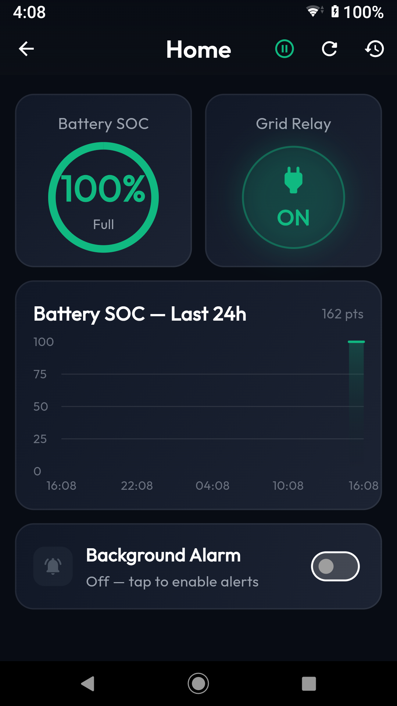
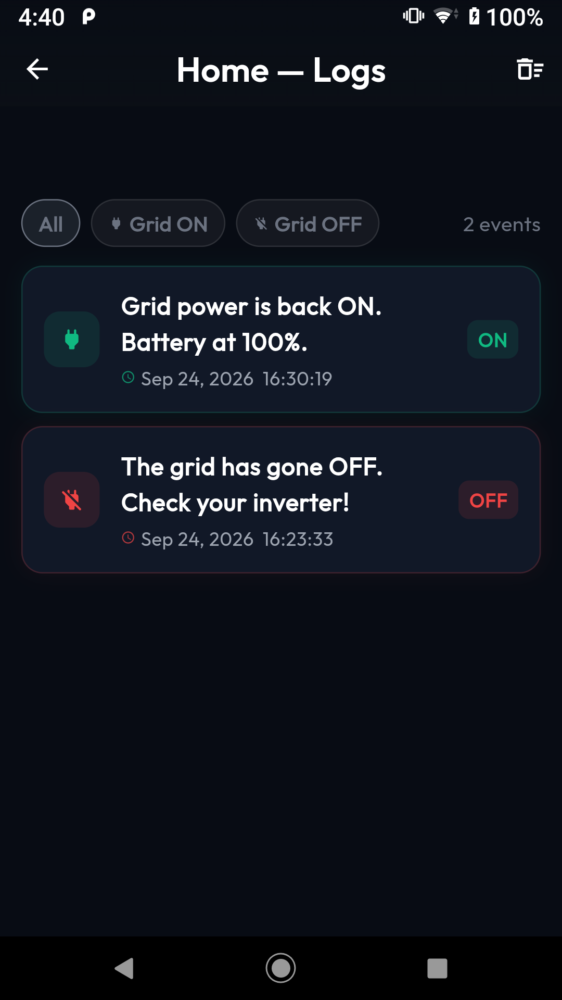
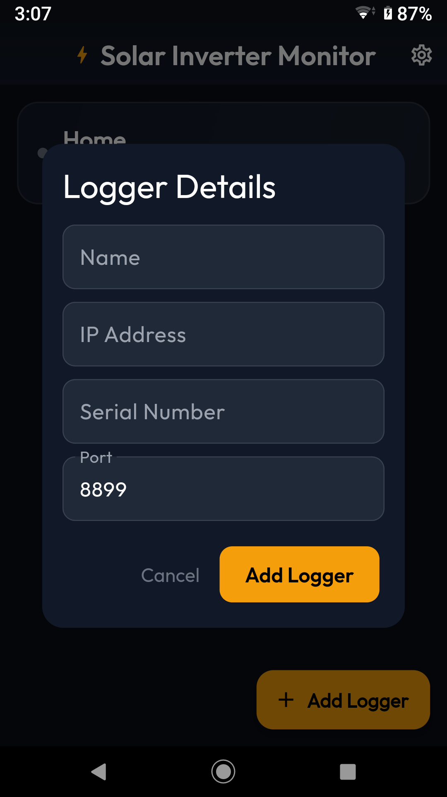
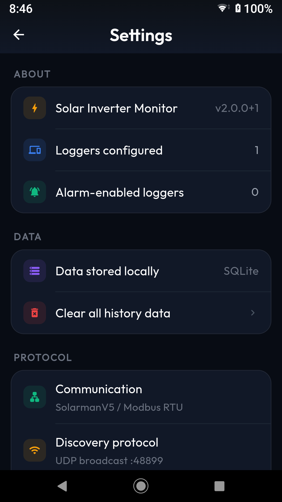

# Solar Inverter Monitor

Solar Inverter Monitor is an Android app for detecting grid outages and restorations through a Solarman-compatible data logger. Its dashboard shows live battery state of charge (SOC), grid relay status, battery charging or discharging power, and PV1 + PV2 power. It also keeps a log of grid changes. When you enable Background Alarm, the app keeps checking the grid status and alerts you to changes even when the dashboard is closed.

**Tested setup:** Deye SUN-5K-SG03LP1-EU hybrid inverter with a Solarman LSW-3 Wi-Fi data logger. The register addresses used by the app come from the [deye_solarman](https://github.com/Mhmdkh77/deye-solarman) Dart library. Other inverter models may use different register layouts.

The app reads inverter data over the local network. It does not need a Solarman account and does not change inverter settings.

## Screenshots

|                                                                 Live dashboard                                                                 |                                                 Grid event log                                                  |
| :--------------------------------------------------------------------------------------------------------------------------------------------: | :-------------------------------------------------------------------------------------------------------------: |
|  |          |
|                                                             Add a logger manually                                                              |                                                    Settings                                                     |
|       |  |

## What you can do

- Add a data logger by scanning the local network or entering its IP address and serial number.
- Save multiple loggers and open a dashboard for each one.
- See battery SOC, grid relay status, battery charging or discharging power, and PV1 + PV2 power while the dashboard is open.
- Enable or disable grid-change alerts separately for each logger.
- Filter the grid event log by outage or restoration.
- Clear a logger's event log, clear all history, or remove a logger and its stored data.

## How the connection works

The phone connects over Wi-Fi to the **data logger**, which relays Modbus requests to the inverter. There are two ways to connect:

- **Home Wi-Fi:** the phone and logger join the same home network.
- **Logger Wi-Fi:** the phone joins the Wi-Fi network created by the LSW-3 logger directly.

You can try scanning on either connection. Scanning uses UDP broadcast to discover the logger's IP address and serial number. For manual setup, use the serial number on the logger's label and its IP address: check the router's device list on home Wi-Fi, or the logger's documentation when connected directly. The app connects over TCP, using port `8899` by default.

Solar Inverter Monitor uses the [deye_solarman Dart library](https://github.com/Mhmdkh77/deye-solarman) for SolarmanV5 communication.

## Run the app

Install the released app from the [Android APK download](https://github.com/Mhmdkh77/solar-inverter-monitor/releases/download/v2.0.0/solar-inverter-monitor-v2.0.0.apk).

To run from source, you need [Flutter SDK](https://docs.flutter.dev/get-started/install) **3.44.0 or newer**, an Android device, and a reachable data logger for live readings. An emulator can show the UI, but it needs network access to the logger for live data.

```sh
flutter pub get
flutter run
```

Set up a logger:

1. Tap **Add Logger → Scan Network** and select your logger. If scanning finds nothing, choose **Add Manually**.
2. Give it a name, confirm its IP address, serial number, and port, then tap **Add Logger**.
3. Open the logger to view its dashboard.
4. Enable **Background Alarm** if you want alerts for grid state changes. Grant notification permission when Android asks.

## Monitoring and local data

While a dashboard is open, it refreshes about every 10 seconds. The pause button stops only these dashboard updates; the refresh button fetches one reading immediately. When Background Alarm is enabled, an Android foreground service checks the enabled logger's grid status about every 30 seconds and shows a persistent notification. Dashboard pause does not stop these background grid checks. Polls can take longer when several loggers are configured or a logger does not respond.

The first valid grid reading establishes the starting state. A later change records a grid-off or grid-on event and, when alerts are enabled, shows an alarm notification. Incomplete or invalid readings are discarded rather than interpreted as an outage. Android notification and full-screen permissions, device settings, and background restrictions affect how prominently an alert appears.

Logger configuration is saved with SharedPreferences. Grid changes are stored locally in SQLite and remain until you clear the event log or remove the logger.

## Register details

The dashboard requests holding registers `184` through `194` and displays Battery SOC (`184`), PV1 and PV2 power (`186`, `187`), Battery Power (`190`), and Grid Relay Status (`194`). On the tested inverter, positive battery power means discharging. The PV figure is the sum of PV1 and PV2.

## Project layout

Tracked source and configuration are shown below. Android sources and screenshots are grouped by directory.

```text
android/
  .gitignore
  app/
    build.gradle
    src/
  gradle/wrapper/gradle-wrapper.properties
  build.gradle
  gradle.properties
  settings.gradle
lib/
  main.dart
  models/
    data_logger.dart
    inverter_reading.dart
  providers/
    data_loggers_provider.dart
  services/
    background_service.dart
    db_helper.dart
  ui/
    dashboard_screen.dart
    event_logs_screen.dart
    home_screen.dart
    settings_screen.dart
    splash_screen.dart
screenshots/
test/
  inverter_reading_test.dart
tool/
  generate_icons.py
.gitignore
.metadata
analysis_options.yaml
LICENSE
pubspec.yaml
pubspec.lock
README.md
```

`lib/` contains the app, `android/` contains its Android configuration, `screenshots/` holds the README images, and `tool/` contains the launcher icon generator.

## Development

The `deye_solarman` Git dependency is pinned to `v1.0.2` in [pubspec.yaml](pubspec.yaml); `flutter pub get` downloads it automatically.

```sh
flutter analyze
flutter test
```

The app supports **Android**. To build a release APK, create your own private Android signing key and `android/key.properties` as described in the [Flutter Android release guide](https://docs.flutter.dev/deployment/android#sign-the-app), then run `flutter build apk --release`.

The launcher artwork is defined in [tool/generate_icons.py](tool/generate_icons.py). To edit and regenerate the Android icon sizes, install Python and Pillow, then run:

```sh
python -m pip install Pillow
python tool/generate_icons.py
```

Python is only needed to regenerate the icons, not to build or run the app.

## License

MIT. See [LICENSE](LICENSE).
